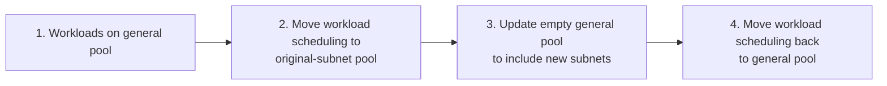

# Solving IP Exhaustion in a Production Kubernetes Cluster

Story time... During an availability-zone incident, we got ready to evacuate workloads into the remaining zones. The issue resolved on the AWS side, so we didn't pull the trigger. The next day, we realized that doing so could have exhausted the private IP space in one of our production VPCs.

Without free addresses, new pods, nodes and load balancers can't start. The system loses its ability to reconcile, deploy and scale.

To address this existential risk, we kicked off two workstreams. One focused on tuning what could be tuned: we ran fewer, larger pods, freeing roughly 6,000 addresses, and reduced the number of warm IPs nodes reserved. The other focused on adding a secondary CIDR and moving production workloads onto four new private subnets.

## Why we were running out

The VPC's `/16` had been divided across four availability zones, with one public and one private `/19` per zone. Those four private subnets provided roughly 32,000 usable addresses.

That had once been generous, but over time the cluster grew from a few thousand pods to tens of thousands. Every pod receives a VPC-routable IP through the AWS VPC CNI, while databases, caches, load balancers, and nodes' warm-IP reserves consume addresses from the same finite space.

The new CIDR doubled our private address capacity. Creating it and its subnets was just one pull request, but making the infrastructure trust the new addresses took a couple dozen.

## A new address is trusted by nobody

A node could launch in a new subnet and Kubernetes could schedule a pod onto it. The pod would receive an IP, then fail to reach its database or internal services.

Years of assumptions about the original range were spread across security groups, route tables, prefix lists, IAM policies, network ACLs, network firewall rules, and bucket policies.

I used an AI coding agent to fan the change out across dozens of files. It did a lot, but to find every single resource that needed updating, I turned to a deterministic tool. I used Datadog's infrastructure catalog and DDSQL to find resources that referenced the original CIDR but not the expanded one.

## The legacy security-group replacement trap

AWS now assigns IDs to individual security-group rules and provides an API to modify them in place. Terraform can use this API when rules are modeled with its newer standalone resources. Unfortunately, very few of our security groups are that way.

Most use the legacy `aws_security_group_rule` resource, where changing `cidr_blocks` is a replacement operation. Terraform revokes the old rule and then authorizes its replacement. On a live database security group, this creates a real interruption window.

Instead of replacing existing rules in place, I added separate rules covering a supernet that included both CIDRs. The old rule kept allowing traffic while Terraform created the new one. It changes the order from `destroy → create` to `create → destroy`.

## Adding a subnet did not rotate any nodes

Once the network paths were ready, I added the subnets to our Karpenter configuration and expected existing nodes to drift gradually onto them.

Nothing happened. Existing nodes were still running in eligible subnets, so Karpenter had no reason to replace them. Karpenter only marks a node as drifted if its current subnet disappears from the eligible set. Karpenter's [drift reasons](https://deepwiki.com/aws/karpenter-provider-aws/5.1-installation-via-helm#drift-reasons) document this subnet-membership check.

In non-production, I rotated the nodes manually. For production, I wanted more control...

## Turning the migration into canary deployments

I first moved a few hand-selected services onto a node pool backed only by the new subnets and watched their rollouts. That validated the basic path, but the cluster runs hundreds of services. Moving all of them in a single infrastructure-level rotation would be too risky.

Instead, I used two node pools:

I temporarily parked the fleet on a pool restricted to the original subnets. With the general pool empty, I updated it to include the new ones. I then moved each service back to the general pool.

Each service moved through its normal Argo Rollout. If a canary failed, that service would roll back automatically. No need to bet the entire cluster on one large node rotation.

*Allocations declined in the original subnets as they increased in the new ones, then converged once the fleet was distributed across both.*

## The trust relationships I still missed

The first miss was inside our environment. An infrastructure worker I moved onto a new subnet lost access to the continuous-delivery system, silently stalling deploys...

The second could not have been found in our repositories. An external vendor filtered traffic by source IP and did not trust the new egress path. I couldn't have found that rule from looking at our codebase, nor could I change it. The workload had to remain pinned to the original subnets until its owner coordinated the allowlist change with the vendor.

## The future

With the four new subnets in service, peak utilization fell enough to restore the headroom needed to safely evacuate an availability zone.

Next, we are working on splitting this large environment across more accounts, VPCs, and Kubernetes clusters. We can still add three secondary CIDRs under AWS's default quota. Eventually, we may also need NAT between private networks as the larger internal address space fills up.
